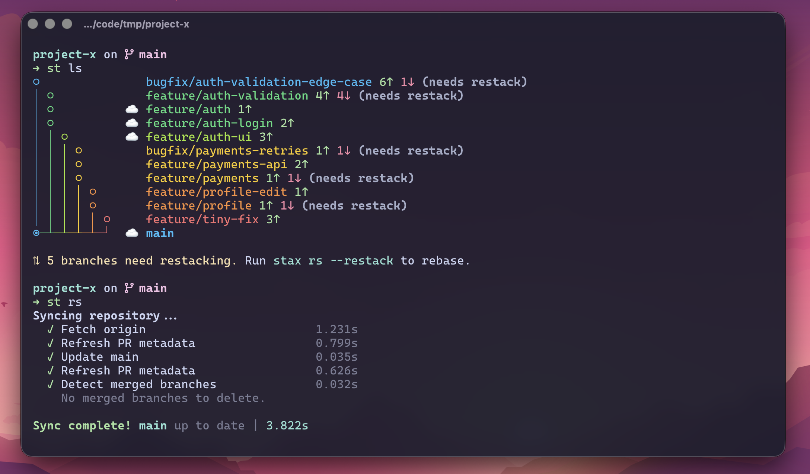
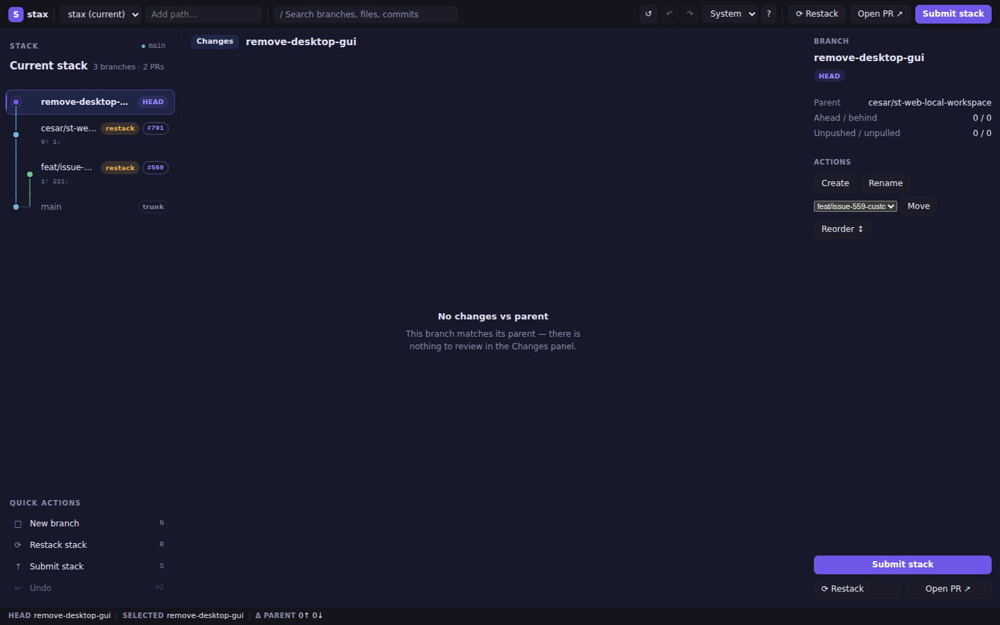
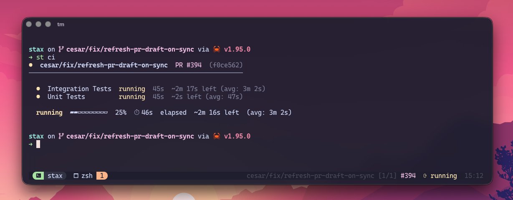

<div align="center">
  <h1>stax</h1>

  <p><strong>Stacked Git branches and PRs — fast, safe, and built for humans and AI agents.</strong></p>

  <p>
    <a href="https://github.com/cesarferreira/stax/actions/workflows/rust-tests.yml">
  </a>
    <a href="https://crates.io/crates/stax"></a>
    <a href="https://crates.io/crates/stax"></a>
    
  </p>

 

  <p>
    <a href="#install">Install</a>
    &nbsp;·&nbsp;
    <a href="#quickstart">Quickstart</a>
    &nbsp;·&nbsp;
    <a href="#commands">Commands</a>
    &nbsp;·&nbsp;
    <a href="https://cesarferreira.github.io/stax/">Docs</a>
  </p>


 
</div>

---

## Why stax

One giant PR is slow to review and risky to merge. A stack of small PRs is the answer — but managing stacks by hand with `git rebase --onto` is a footgun. **stax** makes stacks a first-class Git primitive.

- **Stack, don't wait.** Keep shipping on top of in-review PRs. `st create`, `st ss`, done.
- **Fast stack status.** In our [benchmark on this repo](docs/reference/benchmarks.md), `st ls` took 11.2 ms on average — about 70× faster than Graphite and 215× faster than Freephite.
- **Agent-native.** Run parallel AI agents on isolated branches (`st lane`), auto-resolve rebase conflicts (`st resolve`), and generate branch names, commit messages, and PR details from real diffs.
- **GitHub-native stacks, automatically.** When your repo has GitHub's native Stacked PRs enabled and `github/gh-stack` is installed, `st ss` registers the stack with GitHub under the hood — zero config, zero extra commands. See [Native GitHub Stacked PRs](#native-github-stacked-prs).
- **Undo-first.** `restack`, `submit`, `sync`, and `reorder` snapshot local branch state so you can recover with `st undo` or reapply with `st redo`.
- **Batteries-included TUI.** Run bare `st` to browse the stack, inspect diffs, and watch CI hydrate live.

> `stax` installs two binaries: `stax` and the short alias `st`. This README uses `st`.

## Install

The shortest path on macOS and Linux:

```bash
brew install cesarferreira/tap/stax
```

<details>
<summary><strong>Other installation methods</strong> — cargo-binstall, prebuilt binaries, Windows, from source</summary>

### cargo-binstall

```bash
cargo binstall stax
```

### Prebuilt binaries

Download the latest binary from [GitHub Releases](https://github.com/cesarferreira/stax/releases):

```bash
# macOS (Apple Silicon)
curl -fsSL https://github.com/cesarferreira/stax/releases/latest/download/stax-aarch64-apple-darwin.tar.gz | tar xz
# macOS (Intel)
curl -fsSL https://github.com/cesarferreira/stax/releases/latest/download/stax-x86_64-apple-darwin.tar.gz | tar xz
# Linux (x86_64)
curl -fsSL https://github.com/cesarferreira/stax/releases/latest/download/stax-x86_64-unknown-linux-gnu.tar.gz | tar xz
# Linux (arm64)
curl -fsSL https://github.com/cesarferreira/stax/releases/latest/download/stax-aarch64-unknown-linux-gnu.tar.gz | tar xz

mkdir -p ~/.local/bin
mv stax st ~/.local/bin/
# Ensure ~/.local/bin is on your PATH:
# echo 'export PATH="$HOME/.local/bin:$PATH"' >> ~/.zshrc
```

**Windows (x86_64):** download `stax-x86_64-pc-windows-msvc.zip` from [Releases](https://github.com/cesarferreira/stax/releases), extract `stax.exe` and `st.exe`, and place them on your `PATH`. See [Windows notes](#windows-notes).

### Build from source

Prereqs:
- Debian/Ubuntu: `sudo apt-get install libssl-dev pkg-config`
- Fedora/RHEL: `sudo dnf install openssl-devel`
- Arch: `sudo pacman -S openssl pkg-config`
- macOS: OpenSSL included

Then:

```bash
cargo install --path . --locked
# or
make install
```

No system OpenSSL? Use the vendored feature:

```bash
cargo install --path . --locked --features vendored-openssl
```

</details>

Verify the install:

```bash
st --version
```

<a id="quickstart"></a>
## Quickstart

Run `st setup` to configure GitHub auth, shell integration, and optional AI agent skills:

```bash
st setup
```

In a GitHub repo you can push to, start on a clean, up-to-date `main`. Use two new files to give each branch its own commit:

```bash
st create auth-api
printf 'Token refresh API\n' > auth-api-demo.md
git add auth-api-demo.md
git commit -m "Document the token refresh API"

st create auth-ui
printf 'Token refresh UI\n' > auth-ui-demo.md
git add auth-ui-demo.md
git commit -m "Document the token refresh UI"

st ls  # auth-ui sits on auth-api, which sits on main
st ss  # open or update both PRs
```

On GitHub, `auth-api` targets `main`, and `auth-ui` targets `auth-api`. That means the top PR shows only the UI commit, not the API work underneath it. Once `auth-api` merges, run `st refresh` from `auth-ui` to update trunk, rebase the remaining branch, and update its PR.

Next: [Quickstart guide and auth alternatives](docs/getting-started/quick-start.md) · [Merge & cascade workflow](docs/workflows/merge-and-cascade.md)

## Highlights

### Parallel AI lanes

Spin up multiple AI agents on isolated branches, all tracked as normal stax branches:

```bash
st lane fix-auth-refresh "Fix the token refresh edge case from #142"
st lane stabilize-ci     "Stabilize the 3 flaky tests in the checkout flow"
st lane api-docs         "Update API docs for the /users endpoint"
```

Each lane is a real Git worktree with normal stax metadata — it appears in `st ls`, participates in restack/sync/undo, and re-attaches via tmux any time. No hidden scratch directories, no lost work.

```bash
st wt         # open the worktree dashboard
st wt rs      # restack every lane at once when trunk moves
st wt promote # move the current lane branch back to the main worktree
st ss         # submit PRs for the ones that are ready
```

Lanes start warm: instead of deleting a removed worktree, stax parks it as a reusable warm slot (resetting it to trunk and running `git clean -fd`, which keeps gitignored dependency directories like `node_modules` or `.venv`). The next lane adopts that slot instead of a cold checkout, so agents keep their built deps and don't re-install from scratch. Set `worktree.reconcile` to re-sync deps on adopt, or `worktree.reuse_slots = false` to opt out.

→ [Agent worktrees](docs/workflows/agent-worktrees.md) · [Multi-worktree workflow](docs/workflows/multi-worktree.md)

<a id="native-github-stacked-prs"></a>
### Native GitHub Stacked PRs

When a GitHub repo has native Stacked PRs enabled, stax can register your submitted PRs as a native GitHub Stack automatically. This requires GitHub's [`github/gh-stack`](https://github.com/github/gh-stack) CLI extension — install it once:

```bash
gh extension install github/gh-stack
# or let stax install it for you:
st doctor --fix
```

That's it — no config needed. From then on, `st ss`/`st bs` auto-link multi-PR stacks under the hood, no extra command required. Existing stax PR body/comment stack links keep working; the native GitHub stack map is added on top. On gh-stack v0.0.8+, stax also prints the repository-scoped Stack number returned by GitHub.

```bash
st ss                    # auto-links native stack when available
st stack link            # manually re-link the current stack
st stack unlink 7        # unstack native Stack #7 remotely
```

Repos without the feature, users without the extension, and non-GitHub remotes keep the existing stax behavior — this is purely additive and never blocks a submit. To turn off gh-stack registration entirely, set `native_stack = "off"` under `[submit]` in `~/.config/stax/config.toml`, or pass `st submit --no-native-stack` for a single run (see [config reference](docs/configuration/index.md#native-github-stacked-prs-gh-stack)). `gh-stack` v0.0.8+ uses GitHub's public Stacks REST API and supports the normal GitHub CLI authentication sources, including `GH_TOKEN`/`GITHUB_TOKEN`. For older link-capable versions, stax strips those overrides before `gh stack` operations so the extension can fall back to an OAuth-authenticated `gh` login. `st doctor` always shows the installed version, marks anything below v0.2.1 as out of date (v0.1.0 added `gh stack merge`, see below; v0.2.1 fixes custom SSH host aliases), and can upgrade it with `st doctor --fix`. Native Stack updates are append-only; to remove or insert PRs, run `st stack unlink <stack-number>` and then link again. Argument-free `st stack unlink` retains the active locally tracked behavior.

→ [Native GitHub Stacks guide](docs/integrations/github-native-stacks.md)

### Cascade stack merge

Merge from the bottom of the stack up to your current branch, with CI and readiness checks:

```bash
st merge                  # local cascade merge
st merge --when-ready     # wait/poll until PRs are mergeable
st merge --ds             # merge ancestors, rebase current branch
st merge --stack          # GitHub/GitLab: preserve lower PR/MR merged state through one tip merge
st merge --stack --full   # stack-merge the full stack even from the middle
st merge --remote         # merge remotely on GitHub while you keep working
st merge --all            # merge the whole stack regardless of position
st merge --ignore-failed-ci  # merge despite a red CI rollup (e.g. only optional checks failed)
```

On GitHub, if the current stack is a confirmed-enabled native GitHub Stack and
`gh-stack` v0.1.0+ is installed, `st merge --stack` delegates to `gh stack
merge` instead — GitHub lands every selected PR up to the tip atomically, or
none of them. Older `gh-stack` versions fall back to the flow below with a
`note:` pointing at `gh extension upgrade stack`.

GitLab stack merge checks project merge settings first, sends `squash: false`,
and accepts only the default preserving method; explicit stack `rebase` or
`squash` is rejected. GitHub also rejects those rewriting methods for multi-PR
stack ranges before mutation because lower PRs could not reach merged state; a
single selected GitHub PR may still use them. Gitea/Forgejo stack merge is not
supported.

→ [Merge and cascade](docs/workflows/merge-and-cascade.md)

### AI conflict resolution

When a rebase stops on a conflict, `st resolve` sends only the conflicted text files to your configured AI agent, applies the result, and resumes the rebase automatically. If the AI returns invalid output, touches a non-conflicted file, or leaves extra conflicts behind, stax bails out and preserves the in-progress rebase so you can inspect or continue manually.

```bash
st resolve
st resolve --agent codex --model gpt-5.6-terra
```

Before each rebase, stax also runs a **preflight repair** that compares the
stored parent boundary against `merge-base(parent, branch)`. When they diverge
sharply — the “my restack hit conflicts on files I never touched” case — stax
automatically uses the merge-base boundary for that rebase and prints a
one-line notice. Silence the notice with `[restack] preflight_warn = false` or
`--quiet`; disable the automatic correction with
`[restack] preflight_auto_repair = false`.

The same preflight also detects **squash-merged parents**: if the first commits
of a branch already landed on the parent as one squash commit, stax rebases only
the commits after them instead of replaying the merged ones and conflicting.

### Undo / redo

`restack`, `submit`, `sync`, and `reorder` each snapshot branch state before they touch anything. Recovery is one command away.

```bash
st restack
st undo
st redo
```

→ [Undo/redo safety](docs/safety/undo-redo.md)

### Interactive TUI

<p align="center">
  
</p>

Bare `st` launches a full-screen TUI for browsing stacks, inspecting branch summaries and cached patches, watching live CI hydrate, and running common ops without leaving the terminal. Stack/Summary/Patch pane visibility is remembered per repo.

→ [TUI guide](docs/interface/tui.md)

### Localhost web workspace

<p align="center">
  
</p>

`st web` starts a secure, browser-based workspace on `127.0.0.1` — the same three-pane layout as the TUI, available everywhere (Linux, macOS, SSH sessions):

```bash
st web            # opens port 8787, or warns and uses a free port if busy
st web --port 0   # ephemeral port
st web --no-open  # start without opening browser; prints URL
```

Run `st web` from anywhere inside a Git worktree, or pass any path inside one; stax discovers and opens the worktree root automatically.

Binds 127.0.0.1 only with an unguessable session token in the URL, CSRF protection on every mutating POST, and one-mutation-at-a-time enforcement. Requests without an `Origin` remain supported; when present, `Origin` must exactly match `http://127.0.0.1:<actual-bound-port>`. No `--host` flag — it cannot be exposed to the network.

→ [Web workspace guide](docs/interface/web.md)

### AI branch names, PR details, and standups

```bash
st create --ai -a --yes   # generate branch name + first commit message
st ss --ai --yes          # generate PR titles/bodies during submit
st gen                    # interactive: PR body, PR title, or commit message (AI)
st generate --pr-body     # non-interactive: refresh PR body from branch diff + context
st generate --pr-title    # non-interactive: refresh PR title from branch diff
st generate --commit-msg  # non-interactive: amend HEAD commit message with AI
st standup --ai           # spoken-style daily engineering summary
st standup --ai --style slack  # Slack-ready Yesterday/Today bullets
st standup --ci           # include CI failures for selected stack branches
st standup --ci --json    # activity + explicit signal availability metadata
```

Each AI feature (`generate`, `standup`, `resolve`, `lane`) can use a different agent/model. `st create --ai`, `st submit --ai`, and `st generate` / `st gen` (PR body/title, commit message) share the `generate` setting. Configure with:

```bash
st config --set-ai
```

Projects can also define PR-specific writing rules in a repo-root `stax.toml` (or globally in `~/.config/stax/config.toml`):

```toml
[ai.generate]
title = "Prefix titles with the issue key"
body = "Include testing and rollout sections"
```

These rules apply to AI-generated PR titles and bodies from `generate` and `submit --ai`; commit-message generation is unchanged.

→ [PR templates & AI](docs/integrations/pr-templates-and-ai.md) · [Reporting](docs/workflows/reporting.md)

<a id="commands"></a>
## Commands

| Command | What it does |
|---|---|
| `st` | Browse your stacks in the terminal |
| `st create <name>` | Stack a new branch on your current branch |
| `st ls` / `st ll` | Show stacks and PR status; `st ll` adds PR details |
| `st ss` | Open or update linked PRs for the current stack |
| `st ci` | Check CI for the stack's PRs |
| `st refresh` | Sync trunk, restack locally, and update the current stack's PRs |
| `st restack` | Rebase the current stack locally without pushing |
| `st merge` | Merge PRs from the bottom of the stack up to your current branch |
| `st undo` / `st redo` | Restore or reapply a recorded local state |

Full reference: [docs/commands/core.md](docs/commands/core.md) · [docs/commands/reference.md](docs/commands/reference.md)

## Performance

Mean times measured with `hyperfine` on this repo. Both timings and speedups can vary by repository and machine.

| Operation | stax | [Freephite](https://github.com/bradymadden97/freephite) | [Graphite](https://github.com/withgraphite/graphite-cli) |
|---|---:|---:|---:|
| List stacks | **11.2 ms** | 2.413 s | 783.3 ms |
| Sync | **2.807 s** | 6.769 s | Not measured |

stax is wire-compatible with Freephite/Graphite for common stacked-branch workflows.

→ [Full benchmarks](docs/reference/benchmarks.md) · [Compatibility notes](docs/compatibility/freephite-graphite.md)

## Configuration

```bash
st config                  # open the config editor
st config --set-ai         # pick AI agent + model
st config --reset-ai       # clear saved AI pairing and re-prompt
st --default-config       # print annotated config template (options + allowed values)
st --skill                 # print bundled AI agent skill (SKILL.md format)
```

Config lives at `~/.config/stax/config.toml`. When `STAX_CONFIG_DIR` is unset,
a repo-root `stax.toml` overlays only the values it sets:

```toml
[submit]
stack_links = "body"   # "comment" | "body" | "both" | "off"
single_stack = "on"    # "on" | "off" — when "off", skip stack-link sync while only one PR exists

[ai.generate]
title = "Prefix titles with the issue key"
body = "Include testing and rollout sections"
```

→ [Full config reference](docs/configuration/index.md)

## Integrations

### tmux

[**stax.tmux**](https://github.com/cesarferreira/stax.tmux) is a TPM-compatible plugin that puts your stack in the tmux status bar and adds keybindings for common actions:

<p align="center">
  
</p>

- Live status bar — branch, stack position, PR state, CI state; auto-refreshes in the background
- Keybindings — `prefix + S` popup, `prefix + ]`/`[` up/down, `prefix + M-s` sync
- Window auto-rename — tmux window title follows the current branch

Install via TPM:

```tmux
set -g @plugin 'cesarferreira/stax.tmux'
```

See the [stax.tmux README](https://github.com/cesarferreira/stax.tmux) for full setup and configuration options.

---

AI and editor integration guides:

- [Claude Code](docs/integrations/claude-code.md)
- [Codex](docs/integrations/codex.md)
- [Gemini CLI](docs/integrations/gemini-cli.md)
- [Hermes](docs/integrations/hermes.md)
- [OpenCode](docs/integrations/opencode.md)
- [pi](docs/integrations/pi.md)
- [PR templates + AI generation](docs/integrations/pr-templates-and-ai.md)

Shared skill/instruction file used across agents: [skills.md](skills.md). Print the version bundled with your install: `st --skill`.

`st changelog` can generate notes between refs, and `st changelog find [query]`
or `st changelog --find [query]` fuzzy-finds commits in the selected range.
Use `--path` to scope either mode to a subdirectory.

<a id="windows-notes"></a>
<details>
<summary><strong>Windows notes</strong> — shell integration, worktrees, tmux</summary>

stax runs on Windows (x86_64) with prebuilt binaries on [Releases](https://github.com/cesarferreira/stax/releases). Most commands work identically, with these limitations:

- **Shell integration is not available.** `st setup` supports bash/zsh/fish only. On Windows:
  - `st wt c` / `st wt go` create and navigate worktrees but cannot auto-`cd` the parent shell. `st wt promote` performs the handoff but likewise requires the printed `cd` command.
  - The `sw` quick alias is not available.
  - `st wt rm` (bare) cannot relocate the shell. Specify: `st wt rm <name>`.
- **Worktree commands still work.** `st wt c/go/ls/ll/promote/cleanup/rm/prune/restack` all function — only the shell-level `cd` is missing.
- **tmux integration requires WSL** or a Unix-like environment. The [stax.tmux](https://github.com/cesarferreira/stax.tmux) plugin is Unix-only.

Everything else — stacked branches, PRs, restack, sync, undo/redo, TUI, AI generation — works on Windows without limitation.

</details>

## Contributing

Before opening a PR, run:

```bash
make test
```

On macOS this uses Docker when available. `make test-native` is the guarded
fallback: it checks the file-descriptor limit, sanitizes the environment, and
runs nextest with the optimized test profile. Native macOS timings can still
vary substantially with endpoint-security tooling, so Docker remains the
recommended full-suite path.

To cut a release, run:

```bash
make release                  # default minor bump
make release LEVEL=patch      # patch bump
make release LEVEL=major      # major bump
```

Release automation regenerates `CHANGELOG.md` with [git-cliff](https://git-cliff.org/) inside `cargo release`'s pre-release hook, grouping the commits since the latest `v*` tag under the new version (config in [`cliff.toml`](cliff.toml)). See [docs/workflows/releasing.md](docs/workflows/releasing.md).

Project docs and architecture: [docs/index.md](docs/index.md). Contributor guidelines: [AGENTS.md](AGENTS.md).

## License

MIT &copy; Cesar Ferreira
