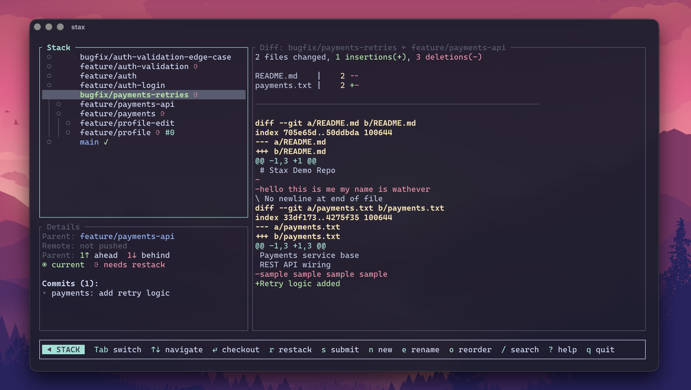

# stax

[](https://github.com/cesarferreira/stax/actions/workflows/rust-tests.yml)
[](https://crates.io/crates/stax)
[](LICENSE)

**Keep working while your first PR is in review.**

Build the UI on top of the API branch instead of waiting for the API to merge. Each gets its own PR, and reviewers see only what that branch adds. stax tracks which Git branches build on each other, opens PRs against the right base, and rebases the remaining branches when the base changes.

[Install](#install) · [Quickstart](#quickstart) · [Commands](#commands) · [Docs](https://cesarferreira.github.io/stax/)

## Install

```bash
brew install cesarferreira/tap/stax
```

Or use `cargo binstall stax`. See the [installation guide](docs/getting-started/install.md) for prebuilt binaries, Windows, and source builds. Both `stax` and its short alias `st` are installed.

## Quickstart

Run `st setup` once to configure GitHub auth and shell integration. Then, in a GitHub repo you can push to, start on a clean, up-to-date `main`. Use two new files to give each branch its own commit:

```bash
st create auth-api
printf 'Token refresh API\n' > auth-api-demo.md
git add auth-api-demo.md
git commit -m "Document the token refresh API"

st create auth-ui
printf 'Token refresh UI\n' > auth-ui-demo.md
git add auth-ui-demo.md
git commit -m "Document the token refresh UI"

st ls
```

```text
◉     auth-ui 1↑
○     auth-api 1↑
○  ☁️ main
```

Read it from the bottom up: `auth-api` builds on `main`, and `auth-ui` builds on `auth-api`. `◉` marks the checked-out branch; `1↑` shows that each branch adds one commit to its parent.

```bash
st ss
```

This opens two linked PRs: **`auth-api` → `main`** and **`auth-ui` → `auth-api`**. The UI PR shows only the UI change, even though the branch already contains the API work.

Once `auth-api` merges, run `st refresh` from `auth-ui` to sync `main`, rebase the remaining branch, and update its PR.

[Setup and auth help](docs/getting-started/quick-start.md) · [Merge and cascade guide](docs/workflows/merge-and-cascade.md)

## Commands

| I want to… | Run |
|---|---|
| Create a branch on top of the current one | `st create <name>` |
| See my stacks and PR status | `st ls` |
| Open or update PRs for the current stack | `st ss` |
| Preview a submit without making changes | `st ss --plan` |
| Sync trunk, rebase, and update the stack's PRs | `st refresh` |
| See which CI checks are failing | `st ci` |
| Merge from the bottom up to my current PR | `st merge` |
| Recover local branch state after a restack or sync | `st undo` |

[Core commands](docs/commands/core.md) · [Full command reference](docs/commands/reference.md)

## Beyond the basics

Run `st` to browse branches, diffs, and CI in the [terminal UI](docs/interface/tui.md), or run `st web` for the [local browser workspace](docs/interface/web.md).



- **Native GitHub stacks.** `st ss` registers a native GitHub stack when the repo has the feature enabled and the `gh-stack` extension is installed. Otherwise you still get linked PRs. [GitHub setup →](docs/integrations/github-native-stacks.md)
- **Parallel work.** Use `st wt` to manage Git worktrees, or `st lane` to run each AI coding session on its own branch and worktree. AI is optional; it can also [draft PR text](docs/integrations/pr-templates-and-ai.md) or [help resolve a rebase conflict](docs/commands/reference.md#st-resolve). [Agent lanes →](docs/workflows/agent-worktrees.md)
- **Recover from a bad restack.** `restack`, `submit`, `sync`, and `reorder` snapshot local branch state. `st undo` restores that state; it doesn't roll back GitHub changes. [Undo and redo →](docs/safety/undo-redo.md)

## More resources

[Configuration](docs/configuration/index.md) · [tmux plugin](docs/integrations/tmux.md) · [AI agent instructions](skills.md) · [Freephite and Graphite compatibility](docs/compatibility/freephite-graphite.md) · [Benchmarks](docs/reference/benchmarks.md)

Contributing? See [repository guidelines](AGENTS.md) and the [release workflow](docs/workflows/releasing.md).

[MIT License](LICENSE)
